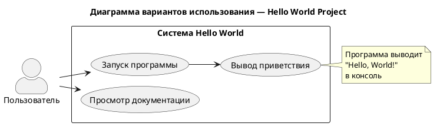
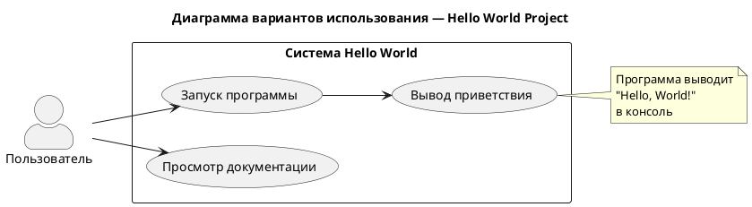

# Hello World Project

**Лабораторная работа №2**  
**Документирование программных проектов: GitHub, Markdown и PlantUML**

---

## Описание проекта

Простая демонстрационная программа на языке **Python**, которая выводит приветствие «Hello, World!» в консоль.  
Проект создан в рамках лабораторной работы для освоения:

- системы контроля версий **Git** и сервиса **GitHub**;
- оформления документации с помощью языка разметки **Markdown**;
- построения диаграмм с помощью инструмента **PlantUML**.

---

## Структура проекта

```
lab2-project/
├── .gitignore              # Исключения для Git
├── README.md               # Этот файл
├── requirements.txt        # Зависимости (пока пусто)
├── src/
│   └── hello_world/
│       ├── __init__.py
│       └── main.py         # Точка входа программы
├── tests/                  # Папка для тестов
│   └── __init__.py
└── docs/
    └── diagrams/
        ├── usecase.puml    # Исходный код диаграммы PlantUML
        └── usecase.png     # Сгенерированное изображение
```

---

## Требования

- Python 3.8 или выше
- Git
- (опционально) Visual Studio Code с расширениями:
  - **Git** (встроенное)
  - **Markdown All in One** или **Markdown Preview Enhanced**
  - **PlantUML** (jebbs.plantuml)

---

## Установка и запуск

1. Клонируйте репозиторий (после публикации на GitHub):

   ```bash
   git clone https://github.com/<ваш-username>/lab2-project.git
   cd lab2-project
   ```

2. (Рекомендуется) Создайте виртуальное окружение:

   ```bash
   python -m venv venv
   # Windows:
   venv\Scripts\activate
   # Linux/macOS:
   source venv/bin/activate
   ```

3. Запустите программу:

   ```bash
   python src/hello_world/main.py
   ```

**Ожидаемый вывод:**

```
Hello, World!
Лабораторная работа №2 выполнена успешно!
```

---

## Диаграмма вариантов использования (Use Case)

Диаграмма построена с помощью **PlantUML** на основе требований лабораторной работы.



### Исходный код диаграммы (`docs/diagrams/usecase.puml`)



---

## Основные команды Git (шпаргалка)

| Действие                    | Команда                                      |
|-----------------------------|----------------------------------------------|
| Инициализация репозитория   | `git init`                                   |
| Добавление файлов           | `git add .`                                  |
| Коммит                      | `git commit -m "Сообщение"`                  |
| Добавление удалённого репо  | `git remote add origin <url>`                |
| Отправка на GitHub          | `git push -u origin main`                    |
| Создание ветки              | `git checkout -b feature-branch`             |
| Слияние                     | `git merge feature-branch`                   |
| Получение изменений         | `git pull origin main`                       |

---

## Автор

Дураков Александр / Выполнил лабораторную работу №2  
Дата: октябрь 2026

---

## Лицензия

Проект создан в учебных целях.  
Можно свободно использовать и модифицировать.
